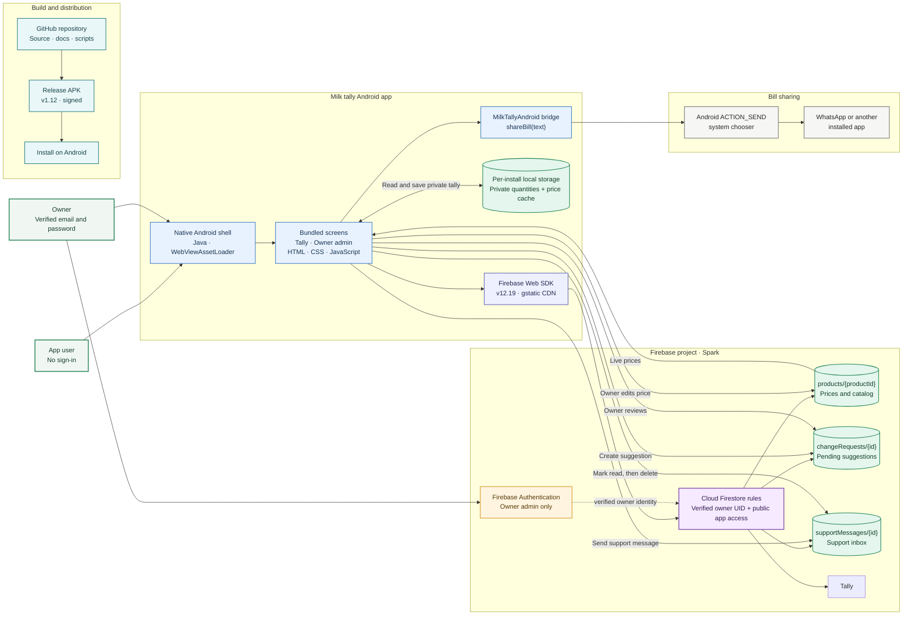

# Milk tally — system design

**Architecture revision:** v1.12
**Android package:** `com.milktally.app`  
**Backend plan:** Firebase Spark

## Architecture overview



The Firebase Web SDK connects from the app directly to Firestore. There is no custom API server between the app and Firebase. Firestore Security Rules are the authorization boundary for every client read and write.

## Runtime flows

| Flow | What happens |
|---|---|
| Tally | Quantities are stored in local storage on each app installation. Plus/minus controls use the product's pack step, while manual entry accepts any whole number. No quantity data is sent to Firestore. |
| Price refresh | Firestore price snapshots update the catalog in the app. The Refresh action can request the latest server values. |
| Price precision | Numeric price values retain their available decimal digits for display and suggestions. Line totals and the overall total multiply and add decimal coefficients without currency rounding. |
| Suggestions | Anyone can submit a bounded price or new-product suggestion. The owner reviews it in the admin panel and approves or rejects it. |
| Direct price edit | The verified owner saves a price from the admin panel to `products/{productId}`; Firestore rules reject that write from anonymous users. |
| Minimum quantity edit | The verified owner saves `quantityMultiple` on the product record. Live Firestore updates replace the app's step size; older records fall back to the bundled default. |
| Support | Anyone can submit a support message. The owner reads it, marks it read, then can delete it. Rules permit deletion only for the verified owner when `readAt` is a timestamp. |
| Bill sharing | JavaScript sends formatted bill text through the native bridge. Android opens the system chooser; the user chooses WhatsApp or another app and sends it. |

## Firestore data model

### `products/{productId}`

Public catalog with `name`, `kind`, `price`, owner-editable `quantityMultiple`, and optional display fields such as `order`, `image`, `badge`, `color`, and `range`.

### Per-installation tally

Stored only in the app installation's local storage (`milkTallyLocalV2`):

```text
quantities: map<productId, integer>
```

Each install has an independent quantity map. The legacy Firestore `sharedData/current` document is ignored by the current app and denied by current rules. Manual quantities can differ from the step size, and plus/minus changes the displayed field by that step.

Default minimum quantities / button steps: Gold 1 L 6, Gold 500 ml 6, Taaza 500 ml 6, Slim ’n Trim 180 ml 5, Masti Dahi 380 g 12, Masti Dahi 85 g 8, and Chaas 400 ml 6. The owner can change each product's value in the admin panel; the app applies the updated value from Firestore. Manual quantity entry remains flexible. New catalog items default to 1 until configured.

### `changeRequests/{id}`

Anonymous users can create validated `price_change` and `new_product` suggestions. The owner can read and update review status.

### `supportMessages/{id}`

Anonymous users can create a message with optional contact text and server `createdAt`. Only the verified owner can read messages, set `readAt`, or delete a message that already has `readAt`.

## Security and service boundaries

- Normal tally use does not require an account. Firebase Email/Password Auth is reserved for the owner admin panel.
- Tally quantities never leave the phone. Approved prices and owner submissions still use Firestore.
- Rules identify the owner by Firebase Auth UID and require a verified email. The owner email and password are not embedded in the app.
- Firebase Web app configuration is public client configuration. Do not put a Firebase service-account key, GitHub token, admin password, or Android signing key in source, docs, or the APK.
- The app uses Firestore and Firebase Authentication. It has no Cloud Run, Cloud Functions, Cloud Storage, Realtime Database, or custom REST API dependency.
- The Android WebView sets a `WebChromeClient` for JavaScript confirmation dialogs. The support delete confirmation must resolve to **Delete** before the Firestore delete request is sent.

## Build and deployment

- Android UI assets are maintained at the repository root and copied to `public/` and the Android WebView bundle by `cloud/sync-app.ps1`.
- `cloud/build-release.ps1` builds the release APK with the local JDK, Android SDK, and keystore. Signing material stays outside the repository.
- `outputs/Milk-tally.apk` is the installable v1.12 release artifact.
- Firebase Hosting configuration exists in `firebase.json`; a live Hosting deployment is separate from the Android APK and is not assumed here.
- Source control and release artifact are in the GitHub repository. GitHub is not used as a runtime dependency by the app.
